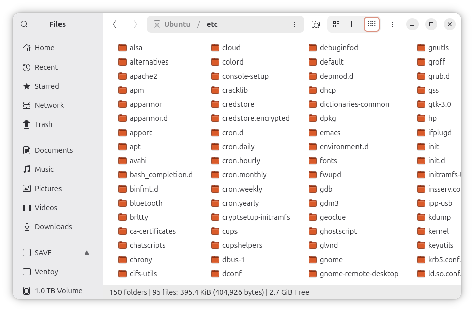
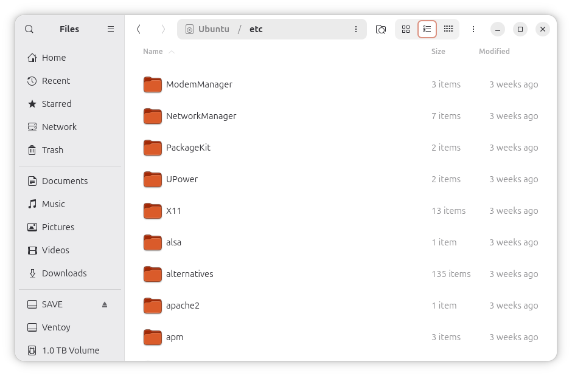
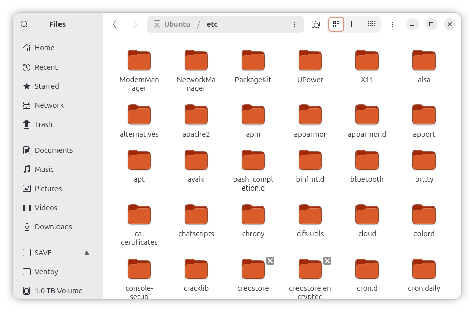
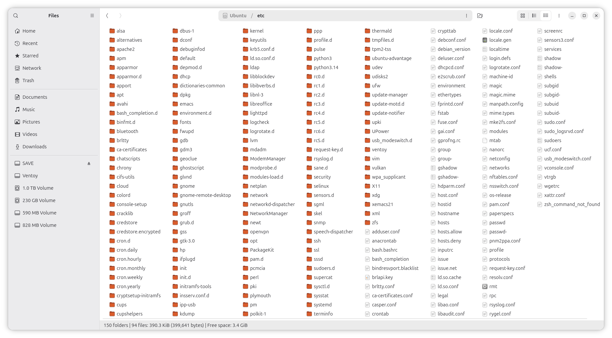
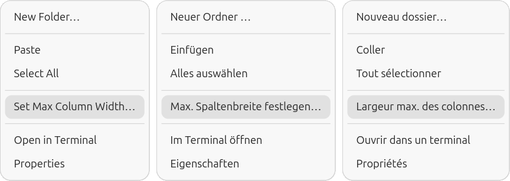
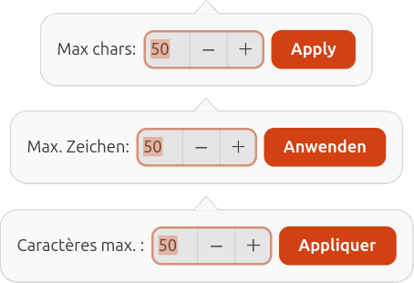
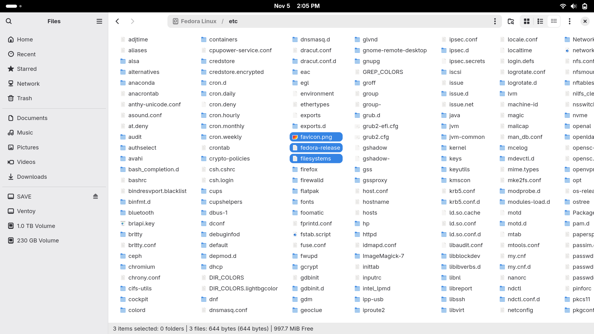
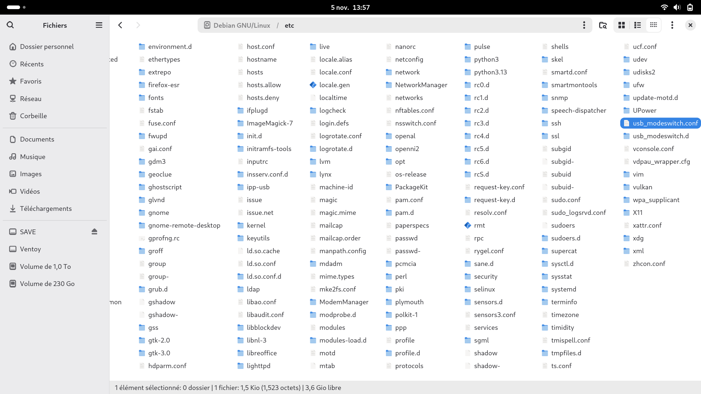

# nautilus-compact-list

**Bringing back the classic multi-column Compact List view (present in GNOME 2 Nautilus, Caja, Thunar, Dolphin, PCManFM/PCManFM-Qt) to modern GNOME Files (GTK4 Nautilus) with variable-width columns, smart filename shortening, and status bar.**

<div align="center">

[](https://github.com/DerLudditus/nautilus-compact-list/actions) [](https://github.com/DerLudditus/nautilus-compact-list/releases/latest) [](https://github.com/DerLudditus/nautilus-compact-list/releases)    
[](https://www.python.org/) [](https://www.gtk.org/) [](LICENSE)

</div>

<div align="center">

The **Compact view** you, as a naïve GNOME user, didn’t know you needed! 👇


You cannot see many files in the **List view**, can you? 👇


The **Icon view** works well with short file names, but it is not a universal fix! 👇


</div>


### 1. Rationale

What kind of listing do you get in a terminal when you execute `ls`? **Think about it!** Now think one more time. Why can’t you get the same view in GNOME’s Files?

Why is GNOME’s file manager the only major file manager to lack a *compact list* view, when such a view was present in the original Nautilus in GNOME 2, is still present in Caja, its successor, and is also one of the standard views in Thunar, Dolphin, PCManFM and PCManFM-Qt? 

Note that even the file manager in Windows 3.0 had a compact view! 🤪 Yes, it did. With the 8.3 character limit and same-width columns, it was easy to implement. What it lacked was an icons or thumbnails view. All it had were the compact and detailed views.

**Less is more, unless it insults my intelligence.** Besides, users of Caja, Thunar, Dolphin, PCManFM and PCManFM-Qt can have something that the users of Files (still `nautilus` under the hood) cannot have, and they are supposed to be happy?!

They are not entirely alone. Users of [`cosmic-files`](https://github.com/pop-os/cosmic-files) and [`dde-file-manager`](https://github.com/linuxdeepin/dde-file-manager) can only use the same two views and two views only. How pathetic!

Typical GNOME users certainly don’t have the same workflow that I do. They might not need to see many files at once. They *literally cannot* use GNOME’s file manager the way I use Thunar and Windows Explorer, which is:
* 70% of the time in a Compact List view
* 20% of the time in a Detailed List view
* 10% of the time in an Icon View

They don’t manage folders with thousands of ePub or MP3 files, or hundreds of MP4/MKV files. Good for them. They have a simple life. They should be using a Mac.

But look, if they had a compact list view, they could see the entire `/etc` directory at once!



This is obviously not mandatory, but it can be accomplished with [`nautilus-compact-list`](https://github.com/DerLudditus/nautilus-compact-list/releases/latest)!


### 2. What it is

In a nutshell:

> [!NOTE]
> **`nautilus-compact-list`** is a standalone, lightweight, in-process `nautilus-python` extension that integrates a full-featured Compact List view into Nautilus. It requires **zero binary patches** to Nautilus or GNOME, integrates seamlessly into the GTK4 widget hierarchy, and synchronizes dynamically with Nautilus’s internal styling.

> [!IMPORTANT]
> **This is vibe coding, or, as Gregory Kurtzer [likes to call it](https://x.com/gmkurtzer/status/2114958282481910115), Human-Directed Agentic Engineering (HDAE). 🙄**

Once I noticed [nautilus-my-computer](https://github.com/yannmasoch/nautilus-my-computer), I knew it could be done. 🎉

What inspired me wasn’t the “My Computer” view, which is a Windows thing that I don’t miss under Linux. It was its newest feature, the [Column View](https://github.com/yannmasoch/nautilus-my-computer#column-view-public-beta), still in beta. These is literally an implementation of [Miller columns](https://en.wikipedia.org/wiki/Miller_columns) and must have been requested by macOS users, because the concept has been around since NeXTSTEP. 

In Linux, [FSViewer](https://github.com/roblillack/fsviewer#fsviewer) had it in WindowMaker, and Pantheon Files (the Elementary OS file manager) [also has it](https://raw.githubusercontent.com/elementary/files/main/data/screenshot-column.png).

Another set of [Nautilus-Extensions](https://github.com/ToFpon/Nautilus-Extensions#-extensions) includes `nautilus-column-browser`, a “Miller-columns (macOS Finder style) folder browser,” but I didn’t try it. **And nobody added a Compact view!**

So I passed a [zipped version of `nautilus-my-computer`](https://github.com/yannmasoch/nautilus-my-computer/archive/refs/heads/main.zip) to Gemini 4 Argon, and told it to sketch a skeleton of a similar extension that would add a third, Compact view, to Files/Nautilus. I had to do so in a browser because I can’t use Argon in Antigravity IDE or CLI. At the “High” thinking level, and for a request like this, I can ask Argon exactly 3 questions in 5 hours.

It produced a 73.5 MiB PLAN.md that included 10 Python files, a `.gschema.xml`, a Makefile, an `install.sh`, a `pyproject.toml`, an SVG, and instructions for the next agent on how to make it a working project.

The next agent was Gemini 3.8 Flash High in Antigravity IDE. It never reached my quota, so it was cheap, but mediocre. But Argon already included a lot of irrational thinking in its skeleton, so I had to iterate a lot, and I mean a lot, especially as Flash also proved capable of creating new bugs and regressions in the process of fixing existing ones. As I was used to, Flash often missed obvious aspects (obvious to a human) or offered intricate solutions instead of simple ones. Human-Directed Agentic Engineering is an art that requires patience and perseverance.

When I was satisfied with the results, I decided to publish the project on GitHub.


### 3. Key features

> [!NOTE]
> I tested this extension on **Debian 13.7 GNOME**, **Debian 13.7 XFCE** with `nautilus` added, **Ubuntu 26.04.1**, **Ubuntu 26.10**, **Fedora Workstation 45**, **Fedora KDE Plasma Desktop 45** with `nautilus` added.
> It should work with any recent version of GNOME. Only the file manager is actually required 🙄

Top 10 relevant features:

- **Multi-column flow layout**: Items flow vertically from top to bottom within columns and wrap from left to right. Horizontal scrolling is translated from vertical mouse-wheel events.
- **Variable-width columns**: Each column auto-sizes to fit its longest entry rather than forcing a uniform grid width, preserving precious horizontal space, with the exception of the last column shown on screen, which in most cases overflows.
- **As-needed scrolling:** Clicking on a partially visible file name in the rightmost column on screen will scroll the view only as needed for that file name to be fully visible.
- **Adjustable maximum column width:** By default, displayed file names are limited to a maximum of 50 characters, but this limit can be adjusted by right-clicking in an empty space and selecting "Set Max Column Width..." (or its localized translation) and entering a different value.
- **Smart suffix-aware filename shortening**: Long filenames exceeding the maximum column width limit are shortened intelligently. Suffixes like copy counters, numeric dates, and extensions are preserved while shortening the stem. Hovering over any shortened filename displays the full unshortened name in a tooltip.
- **Independent icon zoom**: Similar to the native Icon and List views, the Compact view supports the zooming of the icons, which impacts the rows spacing. This view supports 3 zoom levels, matching the behavior of the  List view. The zoom levels remain distinct for each view.
- **Headerbar view switcher**: To be able to switch between the Icon, List, and Compact views, this extension injects a toggle button directly into Nautilus's view-switcher container, forming an integrated 3-way segmented button group: Icon, List, Compact.
- **Same selections and actions as the native views**: Selections and actions, using the mouse or the keyboard, work as they would in an Icon or List view.
- **Bottom status bar**: Similar to Thunar's visual metaphor, the Compact view displays real-time directory and selection statistics, localized by the system, not by the extension.
- **Enhanced functionality when used outside a full GNOME desktop:** When Nautilus (Files) is installed on a system that only includes another desktop environment, right-clicking in an Icon or a List view doesn't display the "Open in Terminal" / "Open in a Console" menu (or their localized versions). However, doing so in a Compact view will offer the respective menu option, which will open the default terminal app for the currently active desktop environment!
 
> [!NOTE]
> The context menu items added by this extension have translations for a good number of major languages in [`./nautilus-compact-list/i18n.py`](./nautilus-compact-list/i18n.py), using a localization catalog that prevents the complication of using `.po` files.

<div align="center">
  
</div>

<div align="center">
  
</div>

### 4. Installation

> [!TIP]
> Grab the latest `.deb` or `.rpm` package from [GitHub Releases](https://github.com/DerLudditus/nautilus-compact-list/releases) and install it.  

Advanced users can install this extension from source. They can also build packages locally.

No, I don’t care about Arch and NixOS.

> [!IMPORTANT]
> **To load this extension and show the extra view button, all Files instances need to be restarted!**
> I personally don’t trust **`nautilus -q`**, so I’d rather do **`killall nautilus`** instead.

The previous screenshots were from Ubuntu, which provides the most usable GNOME customization out of the box (minimize, maximize, and close buttons, the left-side dock, and more), but let’s have other examples, too.

**Fedora 45**, 125% desktop scaling:



**Debian 13**, 125% desktop scaling, in French:



### 5. Advanced configuration

Settings can be customized via the GUI, GNOME GSettings CLI, or direct JSON configuration.

#### i. Via the context menu (GUI)
As previously noted, right-click on any empty area inside the Compact view and choose **Set Max Column Width…** to open an interactive configuration dialog.

#### ii. Via GSettings CLI
```bash
# Set maximum column width in characters (15-200, default: 50)
gsettings set io.github.nautilus-compact-list max-column-width-chars 60

# Set shortening mode ('smart-suffix' or 'middle')
gsettings set io.github.nautilus-compact-list shortening-mode 'middle'

# Set icon size (16, 32, or 64)
gsettings set io.github.nautilus-compact-list icon-size 32
```
This is particularly useful if you hate my `smart-suffix` mode!

#### iii. Fallback JSON configuration
If GSettings schemas are not compiled in your local environment, settings are automatically managed in `~/.config/nautilus-compact-list/settings.json`.

As I said, you don’t need the entire GNOME to run `nautilus`!

### 6. Architecture

For an AI-generated explanation of the runtime widget injection and other mechanisms, see [ARCHITECTURE.md](ARCHITECTURE.md).

### 7. License

This project is licensed under the [MIT License](LICENSE).
